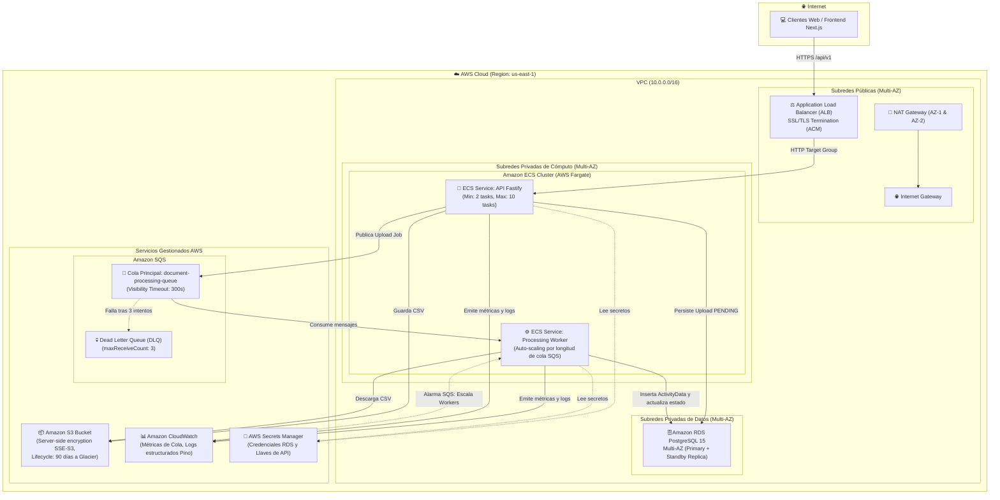

# Arquitectura Cloud en AWS — CarbonBox Async Document Processing

Este documento describe la arquitectura empresarial de grado de producción diseñada para desplegar el sistema **CarbonBox** en Amazon Web Services (AWS), garantizando alta disponibilidad, escalabilidad horizontal, seguridad por diseño y tolerancia a fallos.

---

## 1. Diagrama de Arquitectura AWS

---

## 2. Componentes y Responsabilidades

### 2.1 Networking & Seguridad Perimetral
- **VPC Segregada**: Rango CIDR `10.0.0.0/16` distribuido en 2 Zonas de Disponibilidad (AZs).
- **Subredes Públicas**: Alojan el Application Load Balancer (ALB) e Internet Gateways/NAT Gateways.
- **Subredes Privadas de Aplicación**: Alojan los contenedores de ECS Fargate sin IPs públicas para aislamiento total.
- **Subredes Privadas de Base de Datos**: Alojan las instancias de PostgreSQL aisladas de internet, accesibles únicamente por los Security Groups de ECS.

### 2.2 Cómputo Elástico (AWS ECS Fargate)
- **API Service (Fastify)**: Corre en contenedores Fargate serverless con auto-scaling basado en uso de CPU (>70%) o latencia de requests.
- **Worker Service**: Escala dinámicamente según la métrica `ApproximateNumberOfMessagesVisible` de la cola SQS de CloudWatch. Cuando la cola crece, se despliegan automáticamente más contenedores trabajadores; cuando la cola está vacía, se reduce al mínimo de tareas.

### 2.3 Almacenamiento & Persistencia
- **Amazon S3**: Bucket privado con cifrado en reposo (SSE-S3), bloqueo de acceso público y políticas de ciclo de vida (transición a S3 Glacier después de 90 días).
- **Amazon RDS PostgreSQL (Multi-AZ)**: Instancia primaria con replicación síncrona en una zona de disponibilidad secundaria para failover automático en menos de 60 segundos ante fallos de hardware.

### 2.4 Mensajería Asíncrona (SQS + DLQ)
- **Queue Principal**: Retención de mensajes de hasta 4 días con tiempo de visibilidad ajustado al tiempo promedio de parseo de CSVs grandes.
- **Dead Letter Queue (DLQ)**: Recibe mensajes que han fallado 3 intentos consecutivos (`maxReceiveCount = 3`), evitando mensajes venenosos (poison pills) y alertando al equipo mediante alarmas de CloudWatch.

### 2.5 Monitoreo y Gestión de Secretos
- **AWS Secrets Manager**: Rotación automática de credenciales de la base de datos inyectadas de forma segura en las variables de entorno de las tareas de ECS.
- **Amazon CloudWatch**: Centralización de logs estructurados JSON provenientes de Fastify y el Worker, con dashboards de rendimiento y métricas de procesamiento.
